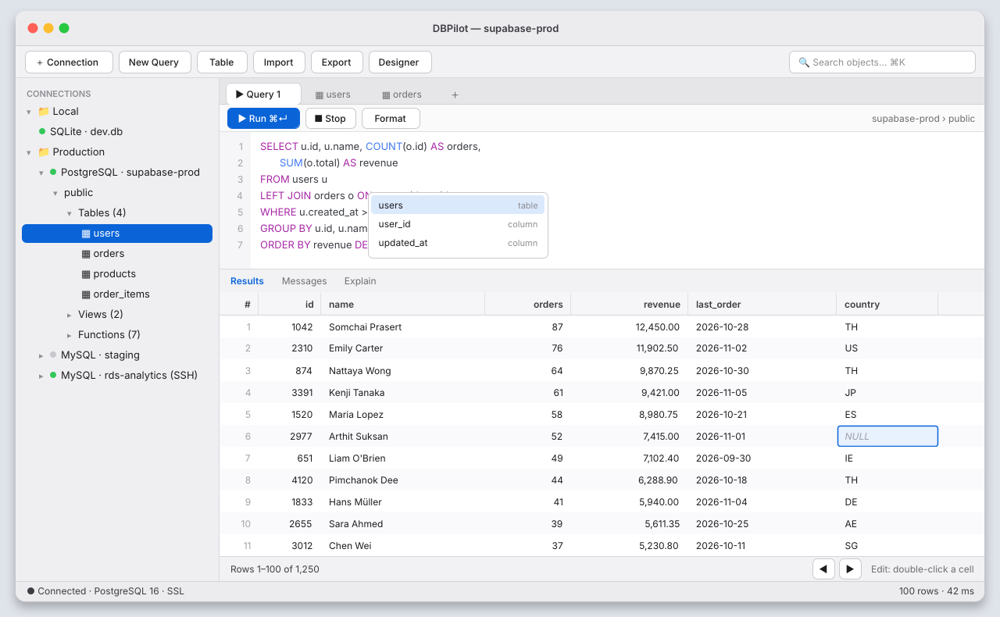
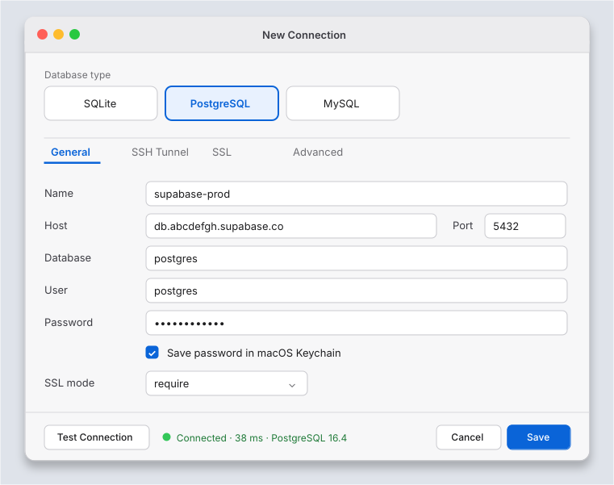

# DataCore ⚡️

> โปรแกรมจัดการฐานข้อมูลแบบเดสก์ท็อปสำหรับ **macOS Apple Silicon** รองรับ **SQLite**, **PostgreSQL** และ **MySQL** พัฒนาด้วย Tauri 2, Rust และ React

[](https://tauri.app/)
[](https://www.rust-lang.org/)
[](https://react.dev/)
[](https://www.typescriptlang.org/)
[-brightgreen)](https://github.com/)

---

## 📸 ภาพตัวอย่างหน้าจอ (UI Mockups)

| หน้าต่างหลัก (Object Browser + Editor + Data Grid) | หน้าต่างสร้าง Connection (Local Encrypted Vault & TLS Security) |
|---|---|
|  |  |

---

## ฟีเจอร์การทำงาน (Features)

### 1. สถาปัตยกรรมและการเชื่อมต่อ (Architecture & Connections)
* **พัฒนาด้วย Tauri 2 + Rust + React 18:** แอปพลิเคชันเดสก์ท็อปขนาดกะทัดรัด คอมไพล์เป็นเนทีฟไบนารีสำหรับ macOS Apple Silicon (ARM64)
* **รองรับ 3 ฐานข้อมูลหลัก:** เชื่อมต่อและจัดการ **SQLite** (ทั้งไฟล์ดิสก์และ `:memory:`), **PostgreSQL** และ **MySQL**
* **ระบบจัดเก็บรหัสผ่าน (Local Encrypted Vault & Session):**
  - **เมื่อเลือก Remember password:** เข้ารหัสรหัสผ่านด้วย **AES-256-GCM** จัดเก็บที่ `~/.datacore/vault.enc` (สิทธิ์ไฟล์ 0600) โดยกุญแจเข้ารหัสถูกผูกกับเครื่อง (`~/.datacore/.vault.key`) ไม่จัดเก็บเป็นข้อความธรรมดา (plaintext) และไม่เรียกใช้ OS Keychain เพื่อลดการแสดงหน้าต่างแจ้งเตือนขอสิทธิ์
  - **เมื่อไม่เลือก Remember password:** จัดเก็บรหัสผ่านเฉพาะในหน่วยความจำ RAM ชั่วคราวระดับ Session และจะถูกล้างทิ้งเมื่อปิดโปรแกรม

### 2. การจัดการธุรกรรมและเซสชัน (Transactions & Sessions)
* **Dedicated Transaction Sessions ต่อแท็บ:** แต่ละแท็บ Query Editor ทำงานบน Connection Session แยกกัน รองรับคำสั่ง Transaction (`BEGIN`, `COMMIT`, `ROLLBACK`), Temporary Tables และตัวแปร Session แยกอิสระในแต่ละแท็บ
* **Transaction Isolation Level Selector:** ปรับเลือกระดับ Isolation ได้บน Editor Toolbar (`Read Committed`, `Repeatable Read`, `Serializable`, `Read Uncommitted`)
* **Savepoint Manager:** คำสั่งสร้าง Savepoint, Rollback to Savepoint, และ Release Savepoint ผ่าน UI พร้อมคำสั่ง SQL Preview
* **Lock Inspector:** หน้าต่างตรวจสอบ Active Sessions และ Table/Row Locks พร้อมปุ่มยกเลิก Blocking Query จากแถบเครื่องมือ Tools

### 3. การวิเคราะห์คิวรีและประสิทธิภาพ (Performance & Query Analysis)
* **Visual Query Explain & Execution Plan:** รองรับคำสั่ง `EXPLAIN` และ `EXPLAIN ANALYZE` (PostgreSQL, MySQL, SQLite) แสดงผลทั้งแบบ Plan Node Tree, ข้อมูลสรุปเวลาประมวลผล (Planning/Execution Time, Total Cost, Estimated Rows) และ Raw JSON/Text
* **Extended Index Support:** รองรับการสร้าง Index หลายรูปแบบใน Table Structure Editor: **B-Tree, Hash, GIN, GiST, Full-text, Composite** และ **Unique**
* **Database Metrics & Buffer Cache Dashboard:** แสดงสถิติ Buffer Cache Hit Ratio, ข้อมูลพื้นที่จัดเก็บ และสถิติต่างๆ ของฐานข้อมูล
* **Table Partitioning Viewer:** ตรวจสอบข้อมูล Partitions ของตาราง (Partition Key, Expression, Row Counts, Storage Size)
* **Views & Materialized Views Management:** ตรวจสอบคำสั่ง DDL ของ View และปุ่มรีเฟรช Materialized View สำหรับ PostgreSQL

### 4. ความปลอดภัยและการเข้ารหัส (Security & Encryption)
* **Row-Level Security (RLS) Management:** เมนูจัดการสิทธิ์ระดับแถวข้อมูลในแท็บ Security ของ Table Designer:
  - สวิตช์เปิด/ปิด RLS (`ALTER TABLE ... ENABLE/DISABLE ROW LEVEL SECURITY`)
  - จัดการ Policy: ตรวจสอบรายการ, สร้าง Policy ใหม่ (`CREATE POLICY`) กำหนด Command (`ALL`, `SELECT`, `INSERT`, `UPDATE`, `DELETE`), Roles, `USING` Expression, และ `WITH CHECK` Expression พร้อมปุ่ม Drop Policy
* **In-Transit Encryption (TLS/SSL):**
  - รองรับโหมด SSL บน PostgreSQL และ MySQL (`disable`, `prefer`, `require`, `verify-ca`, `verify-full`)
  - **Live Connection Security Inspector:** ตรวจสอบ Cipher Suite, TLS Protocol Version, และ Bit Strength ของการเชื่อมต่อปัจจุบัน
* **At-Rest Storage Encryption:** ตรวจสอบสถานะการเข้ารหัส Local Vault (AES-256-GCM) และ Transparent Data Encryption (TDE) ของเซิร์ฟเวอร์
* **Security Audit Trail:** บันทึกประวัติกิจกรรมสำคัญลงในเครื่องแบบ Append-Only พร้อมตรวจสอบความถูกต้องด้วย Cryptographic Hash Chain และส่งออกข้อมูลเป็น CSV/JSON

### 5. การจัดการตารางและการถ่ายโอนข้อมูล (Table Management & Transfers)
* **Table List View & Metadata Grid:** ดับเบิลคลิกที่โหนด Tables ใน Object Browser เพื่อดูรายการตาราง พร้อมรายละเอียด (จำนวนแถว, ขนาดข้อมูล, ขนาด Index, Storage Engine, Collation) และช่องค้นหา/จัดเรียง
* **Foreign Keys & Constraints Manager:** แถบจัดการ Foreign Keys และ Constraints (`CHECK`, `UNIQUE`) ใน Table Designer พร้อม Live SQL Preview
* **การบำรุงรักษาตาราง (Table Maintenance):** สั่งการบำรุงรักษาตารางผ่าน UI (OPTIMIZE, VACUUM, ANALYZE, REINDEX, CHECK TABLE)
* **Duplicate Table:** คัดลอกตารางพร้อมโครงสร้างหรือข้อมูลใน Database เดียวกัน (Structure Only หรือ Structure + Data)
* **Cross-Database Table Transfer:** คัดลอกตารางข้าม Connection หรือ Engine (SQLite ⟷ PostgreSQL ⟷ MySQL) พร้อมแปลงชนิดข้อมูลระหว่างเอนจินอัตโนมัติ และสตรีมมิ่ง Batch Inserts ทีละ 500 แถว
* **Streaming SQL/CSV/JSON Import & Export:** นำเข้าและส่งออกข้อมูลตารางหรือผลลัพธ์ Query เป็น `.sql`, `.csv`, `.json` พร้อมตัวแยกคำสั่ง SQL และรองรับคำสั่ง `DELIMITER`

### 6. ส่วนติดต่อผู้ใช้และการนำทาง (UI & Navigation)
* **ตารางข้อมูล (Glide Data Grid):** แสดงผลข้อมูลตารางด้วย Glide Data Grid บน Canvas แบ่งหน้าทีละ 100 แถว, แสดงผลค่า `NULL` ชัดเจน, รองรับ Inline Edit / Insert Row, Filter Bar และ Cell Detail Drawer
* **Global Tools Dropdown Menu:** เมนูเครื่องมือส่วนกลางบน MainToolbar เข้าถึง Metrics, Locks, Audit Log, Query History & Snippets, และ Connection Security
* **Query History & Saved Snippets:** บันทึกประวัติคำสั่ง SQL ย้อนหลัง 200 รายการ พร้อมระบบบันทึก Snippet คำสั่งที่ใช้บ่อย
* **Command Palette (⌘K / ⌘P):** ค้นหาคำสั่ง, สลับ Connection หรือเปิด Table/View ได้ผ่านคีย์บอร์ด
* **Connection Folder Grouping:** จัดกลุ่มการเชื่อมต่อเป็นโฟลเดอร์ พร้อมเลือกสีโฟลเดอร์
* **Application Visual Identity:** ไอคอนแอปพลิเคชันขอบมนตามแนวทาง macOS Human Interface Guidelines (HIG)

### 7. การเขียนคิวรีและตัวช่วยสร้างคำสั่ง (Querying & Editor)
* **Visual Query Builder (No-Code SELECT Query Builder):** สร้างคำสั่ง SELECT Query ผ่านหน้าต่าง UI โดยเลือกข้อมูลจากตาราง:
  - เลือกตารางหลัก (Base Table) และกำหนด Alias
  - เลือกคอลัมน์ พร้อม Alias และฟังก์ชันสรุปผลรวม (COUNT, SUM, AVG, MIN, MAX)
  - กำหนด Table JOINs (INNER, LEFT, RIGHT, FULL) พร้อมเงื่อนไข ON
  - กำหนดตัวกรองเงื่อนไข WHERE (equals, contains, between, is null ฯลฯ) สลับระหว่าง AND / OR
  - กำหนดการจัดเรียง (ORDER BY) และจำนวนแถว (LIMIT / OFFSET)
  - แสดง Live SQL Preview พร้อมปุ่ม Copy, Open in SQL Editor หรือรัน Query แสดงผลใน Data Grid ทันที
* **Schema-Aware Autocomplete สำหรับ SQL Editor:** แนะนำคำสั่งอัตโนมัติใน CodeMirror 6 จากโครงสร้างจริงของฐานข้อมูล แนะนำชื่อตาราง, Views, และคอลัมน์พร้อมประเภทข้อมูลเมื่อพิมพ์คำสั่ง `FROM`, `JOIN`, `SELECT` หรือ `<table>.` พร้อม Invalidate Cache เมื่อมีคำสั่ง DDL (`CREATE`, `ALTER`, `DROP`)
* **SQL Formatter (⌘⇧F) & Multi-Result Tabs:**
  - จัดรูปแบบโค้ด SQL ด้วย `sql-formatter` รองรับ dialect ของ PostgreSQL, MySQL และ SQLite ผ่านปุ่มบน Toolbar หรือคีย์ลัด `⌘⇧F` (Mac) / `Ctrl+Shift+F`
  - รองรับการรันสคริปต์ที่มีหลายคำสั่ง แสดงผลลัพธ์แยกแท็บย่อย (`Result 1`, `Result 2`, `Messages`)
* **Horizontal Split Layout สำหรับหน้าจอกว้าง:** สลับโหมดแบ่งหน้าจอระหว่าง Vertical Split (บน/ล่าง) และ Horizontal Split (Editor ซ้าย / Data Grid ขวา) พร้อมปรับขนาดได้ และจดจำการตั้งค่าใน `localStorage`
* **Mutation Impact Preview:** พรีวิวผลกระทบของคำสั่ง `DELETE` / `UPDATE` เพื่อตรวจสอบจำนวนแถวที่จะได้รับผลกระทบ โดยระบบจำลองคำสั่งภายใต้ Transaction และทำการ Rollback 100% เสมอ

### 8. การรองรับภาษา สถาปัตยกรรม และการเข้าถึง (Localization & Architecture)
* **ระบบ Internationalization (i18n):** รองรับภาษาไทย (th) และภาษาอังกฤษ (en) สลับภาษาได้บน Toolbar และ StatusBar โดยไม่ต้องรีสตาร์ทแอป และบันทึกค่าไว้ใน `localStorage`
* **Deep Tree Object Browser:** ขยายโหนด Table ในแถบด้านข้างเพื่อดูรายชื่อ Columns พร้อมประเภทข้อมูลและไอคอน PK/FK (Lazy-loaded) และรองรับการ Drag & Drop หรือดับเบิลคลิกเพื่อแทรกลงใน Editor
* **Keyboard Splitter Navigation (Accessibility):** แถบแบ่งหน้าจอ (Splitter) ใน DockLayout รองรับมาตรฐาน `role="separator"`, `tabIndex={0}` และสามารถปรับขนาดได้ด้วยปุ่มลูกศรบนคีย์บอร์ด
* **Modular UI Architecture:** แยกหน้าจอ `TableStructureEditor` ออกเป็น 5 Sub-tabs ย่อย (`ColumnsTab`, `IndexesTab`, `ForeignKeysTab`, `ConstraintsTab`, `RlsSecurityTab`) เพื่อความสะดวกในการบำรุงรักษา และปรับพารามิเตอร์ IPC ให้เป็น camelCase มาตรฐานเดียว

---

## 🛠 Tech Stack

### Backend (Rust)
- **Tauri 2**: Framework สำหรับ Desktop Application
- **Tokio**: Asynchronous Runtime สำหรับ Rust
- **sqlx**: Database Driver สำหรับ PostgreSQL และ MySQL (พร้อม `tls-rustls` และ Connection Pooling)
- **rusqlite**: Database Driver สำหรับ SQLite (เปิดใช้ feature `bundled` และ `column_decltype`)
- **aes-gcm / rand**: เข้ารหัสรหัสผ่าน Local Vault แบบ AES-256-GCM
- **serde / serde_json**: Serialization / Deserialization ข้อมูลระหว่าง Rust และ Frontend
- **csv**: Streaming CSV Reader / Writer

### Frontend (React & TypeScript)
- **React 18 + TypeScript + Vite**: UI Framework, Compiler และ Build Tool
- **@glideapps/glide-data-grid**: Data Grid บน HTML5 Canvas
- **CodeMirror 6 (@codemirror/lang-sql)**: SQL Editor พร้อม Syntax Highlighting & Keymaps
- **react-arborist**: Tree Component สำหรับ Object Browser
- **Zustand**: Client State Management (`tabStore`, `connectionStore`, `auditLogStore`, `snippetStore`, `folderStore`, `queryHistoryStore`)
- **Tailwind CSS**: Styling และ Dynamic Theme Management (Dark/Light Mode)
- **lucide-react**: ไอคอน SVG
- **Vitest**: Unit & Component Testing

---

## 📁 โครงสร้างโปรเจกต์ (Project Structure)

```text
DataCore/
├── src-tauri/                     # Rust Backend (Tauri 2)
│   ├── Cargo.toml                 # Rust dependencies
│   ├── tauri.conf.json            # การตั้งค่าหน้าต่าง macOS Overlay & App Icon
│   └── src/
│       ├── main.rs / lib.rs       # Entry point และ Tauri Builder
│       ├── models/                # Data Contract (QueryResult, CellValue, ConnectionConfig, Transfer)
│       ├── drivers/               # Database Drivers (SQLite, Postgres, MySQL)
│       ├── services/              # Encrypted Vault, Data Transfer, Cross-DB Transfer, SQL Transfer
│       ├── session/               # SessionManager (Dedicated Tab Sessions)
│       └── commands/              # Tauri IPC Command Handlers
├── src/                           # React Frontend (TypeScript)
│   ├── api/                       # Tauri IPC API Wrapper (`db.ts`, `securityHelpers.ts`, `performanceHelpers.ts`)
│   ├── stores/                    # Zustand Stores (`tabStore.ts`, `connectionStore.ts`, `auditLogStore.ts`)
│   ├── types/                     # TypeScript Type Definitions (`types/db.ts`, `dataTransfer.ts`)
│   └── components/
│       ├── chrome/                # MainToolbar (Tools Menu), StatusBar
│       ├── sidebar/               # Object Browser Tree View, DbBadge
│       ├── editor/                # SQL Query Editor, EditorToolbar, HistorySnippetsDrawer
│       ├── grid/                  # Glide Data Grid, Pagination, Cell Detail Drawer
│       ├── tablelist/             # Table List View & Detailed Metadata Grid
│       ├── structure/             # Create Table, Drop Table, Rename Table, Table Structure Editor (RLS)
│       ├── performance/           # DatabaseMetricsModal, TablePartitionsModal
│       ├── transactions/          # LockInspectorModal, SavepointModal
│       ├── security/              # AuditLogDrawer, ConnectionSecurityModal
│       ├── transfer/              # Cross-DB Copy, Duplicate Table, SQL/CSV/JSON Import/Export
│       ├── dialogs/               # Connection Manager Dialog & Driver Forms
│       └── layout/                # TitleBar (macOS Traffic Lights) & DockLayout
├── docs/                          # เอกสารข้อกำหนดและแผนการพัฒนา
│   ├── db-manager-plan.md         # แผนโปรเจกต์และ Tech Stack ฉบับสมบูรณ์
│   └── superpowers/plans/         # แผนการพัฒนาแบบละเอียด (Implementation Plan)
├── tests/                         # End-to-End Workflow Tests
├── Makefile                       # คำสั่งลัดสำหรับการพัฒนา
└── package.json                   # Frontend dependencies
```

---

## 🚀 การติดตั้งและเริ่มต้นใช้งาน (Getting Started)

### สิ่งที่ต้องเตรียม (Prerequisites)
1. **macOS** (แนะนำ Apple Silicon M1/M2/M3/M4)
2. **Xcode Command Line Tools**:
   ```bash
   xcode-select --install
   ```
3. **Node.js** (v20+ หรือ v26) และ **pnpm**:
   ```bash
   corepack enable && corepack prepare pnpm@latest --activate
   ```
4. **Rust Toolchain**:
   ```bash
   curl --proto '=https' --tlsv1.2 -sSf https://sh.rustup.rs | sh -s -- -y
   ```

---

### ติดตั้งและรันโปรแกรม

```bash
# 1. ติดตั้ง Dependencies
make install

# 2. รันแอปพลิเคชันในโหมด Desktop Development (Tauri 2)
make dev

# หรือรันเฉพาะ Frontend Vite Dev Server ใน Browser
make dev-web
```

---

## 📜 คำสั่ง Makefile ทั้งหมด (Make Commands)

| คำสั่ง | คำอธิบาย |
|---|---|
| `make install` | ติดตั้ง Dependencies ของ Frontend ทั้งหมดผ่าน `pnpm` |
| `make dev` | รันแอปพลิเคชัน Desktop ในโหมด Development (Tauri 2) |
| `make dev-web` | รันเฉพาะ Vite Web Dev Server สำหรับทดสอบ UI บน Browser |
| `make test` | รันชุดการทดสอบทั้งหมด (ทั้ง Rust Backend 87 tests และ Vitest 820 tests รวม **907 tests ผ่าน 100%**) |
| `make test-backend` | รันเฉพาะ Unit & Integration Tests ฝั่ง Rust Backend |
| `make test-frontend`| รันเฉพาะ Unit & Component Tests ฝั่ง React Frontend |
| `make check` | ตรวจสอบ Compilation (`cargo check`) และ TypeScript Type Checking (`tsc`) ทั้งระบบ |
| `make lint` | ตรวจสอบ Code Quality และคำเตือนด้วย Cargo Clippy |
| `make build` | Build เป็น Production Desktop Application สำหรับ macOS (.app / .dmg) |
| `make build-frontend`| Build เฉพาะ Production Bundle ฝั่ง Web Assets (Vite) |
| `make clean` | ลบไฟล์ Build Artifacts ทั้งหมด (`dist/` และ `src-tauri/target/`) |

---

## 🧪 การทดสอบ (Testing)

โปรเจกต์นี้ได้รับการพัฒนาด้วยแนวทาง **Test-Driven Development (TDD)** โดยมีชุดการทดสอบรวม **907 tests (ผ่าน 100%)**:

```bash
# รันเทสต์ทั้งหมด
make test
```

* **Rust Backend (87 tests):**
  - Data Contract Serialization & Roundtrip
  - Local Encrypted Vault (AES-256-GCM) Persistence, File Permissions (0600) & Argon2id Master Password KEK Derivation
  - Connection Store Atomic Persistence & Isolation
  - SQLite Dynamic Type Extraction, Pagination, Interrupt Cancellation & Multi-Statement Batch Script Execution
  - Dedicated Session Lifecycle & Explicit Rollback on Close
  - Schema Metadata Connection Isolation
  - Table List View Metadata Query & Size Calculation (SQLite)
  - Duplicate Table Native SQL Cloner & Options Validation
  - SQL Script Splitter & Multi-Statement Parsing with Quote/Comment Awareness & `DELIMITER`
  - SQL Export & Import Lifecycle (SQLite)
  - CSV & JSON Streaming Data Transfer, Delimiter Detection, Column Mapping & Cancellation
  - Cross-Database Table Transfer: Cross-Engine Data Type Mapping (`SQLite` ⟷ `PostgreSQL` ⟷ `MySQL`), DDL Generation & Streaming Batch Inserts
  - Path Traversal Guard: ป้องกัน Directory Traversal (`../`), System Paths และ Sensitive User Directory Exposure
  - Tamper-Evident Cryptographic Hash Chain Audit Logger (Append-only, SHA-256 Hashing, Rotation & Verification)
  - Mutation Impact Preview Simulation Engine (Guaranteed 100% Rollback)
* **React Frontend (820 tests):**
  - Zustand Stores (`tabStore`, `connectionStore`, `auditLogStore`, `snippetStore`, `folderStore`, `queryHistoryStore`, `schemaStore`, `pendingChangesStore`)
  - Object Browser Tree Component, Deep Tree Columns Drill-down (Lazy-loading, Types, PK/FK Badges, Drag & Drop), Node Navigation, Context Menu, Connection Color Folders
  - CodeMirror 6 SQL Editor, Dialects, Schema-Aware Autocomplete, Keymap (`⌘+Enter`, `⌘⇧F`), Toolbar Actions
  - Glide Data Grid Canvas Integration, NULL Indicators, Cell Detail Drawer, Inline Row Editing / Row Insertion
  - Visual Query Builder Tab: Base Table, Columns & Aliases, Aggregates, Multi-Table JOINs, Filter Conditions (AND/OR), Sorting, Limit, Live SQL Preview & SQL Editor Export
  - Internationalization (i18n): Thai & English translations, Instant Reactive Language Switcher, LocalStorage Persistence
  - SQL Formatter Helper, Multi-Result Tabs Sub-layout, Horizontal/Vertical Split Layout Persistence
  - Table Structure Editor & Modular Sub-tabs (`ColumnsTab`, `IndexesTab`, `ForeignKeysTab`, `ConstraintsTab`, `RlsSecurityTab`)
  - Table Management Modals (Create Table, Drop Table with CASCADE, Rename Table, Maintenance Modal)
  - Extended Indexes, Foreign Keys & Constraints Managers with Live SQL Preview
  - Row-Level Security (RLS) Manager, Enable/Disable Toggle, Policy Editor, Drop Policy
  - Connection Security Modal: In-Transit TLS Inspection & At-Rest Encryption Status
  - Table List Tab View: Detailed Metadata Grid, Formatting Helpers (Bytes & Row Count), Sorting, Searching, and Right-Click Context Menu
  - Duplicate Table Modal, SQL/CSV/JSON Import & Export Modals, Cross-Database Copy Modal
  - Connection Dialog Form Switching, Latency Measurement, SSL Mode Configuration
  - Database Metrics Modal, Lock Inspector Modal, Audit Log Drawer, History & Snippets Drawer, Impact Preview Modal, Command Palette
  - DockLayout Splitter Accessibility (ARIA `role="separator"`, `tabIndex={0}`, keyboard navigation)
  - End-to-End User Journey Workflow Test

---

## 🗺 แผนการพัฒนาและประวัติ Phase (Roadmap & Milestones)

- [x] **Phase 1-5: Foundations, UI Shell & DataGrid** (Tauri 2, Tailwind, Glide Data Grid, macOS Titlebar)
- [x] **Phase 6-10: In-Grid Search, Staging Mode, Input Sanitization & Safe Row Deletion**
- [x] **Phase 11-15: Cell Detail Drawer Diffs, ObjectBrowser Double-Click, Table Rename & Maintenance Suite**
- [x] **Phase 16-20: Metrics Isolation, Streamlined Cell Editing, SQLite Native File Picker & Connection Folders**
- [x] **Phase 21-23: Query History & Snippets, Query Explain Visualizer, Foreign Keys & Constraints**
- [x] **Phase 24: Brand Icon & App Icon Updates** (ปรับปรุงไอคอนตามแนวทาง macOS HIG)
- [x] **Phase 25: Transactions, Performance Metrics & Audit Log** (ACID Transactions, Extended Indexes, Cache Metrics, Partitioning Viewer, Audit Log)
- [x] **Phase 26: MainToolbar Tools Menu & Global Drawers Integration**
- [x] **Phase 27: Row-Level Security (RLS) Manager, In-Transit TLS & At-Rest Encryption Inspector**
- [x] **Phase 28: Visual ER Diagram Viewer & Designer** (Topological Layout, Pan & Zoom, SVG Export)
- [x] **Phase 29: Database Schema Comparison & Synchronization** (Schema Diff, UP/DOWN Migration Scripts)
- [x] **Phase 30: Server Activity Monitor & Process List** (Active Sessions, Query Termination, Auto-Refresh)
- [x] **Phase 31: Comprehensive Data Import/Export Wizard** (Multi-step Column Mapping, CSV/JSON/TSV)
- [x] **Phase 32: Database User & Privilege Manager** (User Lifecycle, GRANT/REVOKE, Host Scopes)
- [x] **Phase 33: UX/UI Updates & Modular Refactoring** (Internationalization i18n th/en, Visual Query Builder, Schema Autocomplete, SQL Formatter ⌘⇧F, Multi-Result Tabs, Horizontal Split Layout, Deep Tree Object Browser, Keyboard Splitter Accessibility, Modular TableStructureEditor Architecture)

---

## 📄 ใบอนุญาต (License)

โปรเจกต์นี้อยู่ภายใต้ใบอนุญาต [MIT License](LICENSE)
