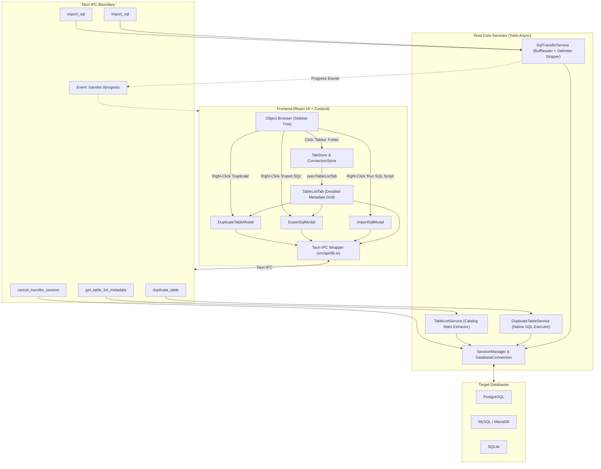

# Table Management & Data Transfer Enhancements

* **Author:** chanchai9666
* **Status:** Approved (Post-EGM Review Remediation)
* **Date:** 2026-11-08

--------------------------------------------------------------------------------

## Overview

ชุดฟีเจอร์ยกระดับการจัดการตารางและการถ่ายโอนข้อมูลสำหรับ DataCore ออกแบบมาเพื่อให้ผู้ใช้งานบน macOS (Apple Silicon) สามารถจัดการตาราง ฐานข้อมูล และการย้ายข้อมูลได้อย่างครบถ้วน รวดเร็ว และประหยัดทรัพยากรตามมาตรฐานสากล โดยมุ่งเน้น 3 ความสามารถหลักในระยะนี้:
1. **Table List View:** หน้าจอภาพรวมตารางระดับ Schema ในรูปแบบ Detailed Metadata Grid (แสดงจำนวนแถวโดยประมาณจากแค็ตตาล็อกระบบ, ขนาดข้อมูล, ขนาด Index, Engine, Collation) โดยไม่เกิด Table Lock
2. **Duplicate Table (Native SQL Quick Clone):** เมนูลัดคลิกขวาทำซ้ำตารางในฐานข้อมูลเดียวกันอย่างรวดเร็ว ทำงานผ่าน Native SQL ของ Database Engine โดยตรง (เสร็จในระดับมิลลิวินาที ไม่ดึงข้อมูลผ่าน Client RAM)
3. **Streaming SQL Import & Export:** ระบบส่งออก DDL/DML และนำเข้าไฟล์ SQL Script ขนาดใหญ่แบบสตรีมมิ่งผ่าน Rust `BufReader` ที่จัดการและกรองคำสั่ง `DELIMITER` ของ MySQL ออกอย่างถูกต้อง พร้อมระบบยกเลิก (Cancellation) ที่ปลอดภัย

## The Problem

ปัจจุบัน DataCore มี Object Browser แสดงรายการตารางในรูปแบบต้นไม้ (Sidebar Tree) และสามารถเปิดดูข้อมูลรายตารางผ่าน Data Grid ได้แล้ว รวมถึงมีระบบ Import/Export ข้อมูลในรูปแบบ CSV และ JSON แต่ยังพบข้อจำกัดสำคัญในการใช้งานจริง:

1. **ขาดภาพรวมระดับ Database/Schema:** เมื่อฐานข้อมูลมีจำนวนตารางมาก ผู้ใช้ไม่สามารถดูภาพรวมเชิงลึก เช่น ตารางใดมีขนาดใหญ่ที่สุด, แต่ละตารางมีจำนวนแถวโดยประมาณเท่าใด, หรือใช้ Storage Engine ใด ทำให้ยากต่อการประเมินและบริหารจัดการ
2. **ไม่มีเครื่องมือโคลนตารางที่รวดเร็ว:** การทดลองปรับเปลี่ยนโครงสร้างหรือทดสอบคิวรีที่มีความเสี่ยงสูง ผู้ใช้ต้องการ Duplicate ตารางเดิมเป็น `table_backup` หรือ `table_copy` ได้ในคลิกเดียว แต่ปัจจุบันต้องเขียนคำสั่ง SQL DDL/DML เองด้วยมือ
3. **ยังไม่รองรับไฟล์ SQL Dump มาตรฐาน:** ในการทำงานจริง ไฟล์สำรองข้อมูลและสคริปต์ส่วนใหญ่ส่งต่อกันในรูปไฟล์ `.sql` หากไม่มีเครื่องมือ Run SQL Script และ Dump SQL File ที่มีประสิทธิภาพและปลอดภัย ผู้ใช้ยังจำเป็นต้องพึ่งพาโปรแกรมบุคคลที่สามภายนอก

## Goals

* **G1 (Table List View):** นำเสนอหน้าจอ Table List Tab เมื่อผู้ใช้คลิกเลือกโฟลเดอร์ `Tables` ใน Object Browser โดยแสดงตารางข้อมูลเมทาดาตาเชิงลึก (Estimated Rows, Data Size, Index Size, Engine, Collation) ดึงจากแค็ตตาล็อกระบบของ DBMS ปราศจาก Table Lock พร้อมช่อง Search Filter
* **G2 (Native SQL Duplicate Table):** พัฒนาระบบ `duplicate_table` ที่รันคำสั่ง Native SQL DDL/DML ภายในฐานข้อมูลเดิมทันที ไม่โหลดข้อมูลผ่านหน่วยความจำของ Client รองรับทั้ง SQLite, PostgreSQL, และ MySQL
* **G3 (Streaming SQL Import/Export):**
  - ส่งออก DDL + Multi-row Batch INSERT (500–1,000 แถว) เป็นไฟล์ `.sql`
  - นำเข้าไฟล์ `.sql` ขนาดใหญ่ระดับหลาย GB ผ่าน Streaming `BufReader` ใน Rust โดยตัดทิ้งและจัดการคำสั่ง `DELIMITER` ของ MySQL อย่างถูกต้องโดยไม่เกิด Syntax Error บน Database Driver
* **G4 (Integrated Architecture & Cancellation):**
  - รวมศูนย์ API Call ทั้งหมดไว้ใน `src/api/db.ts` และต่อยอดโมเดลจาก `data_transfer.rs`
  - รองรับการกดยกเลิก (Cancellation) ผ่านกลไก Database Session ที่มีอยู่เดิม พร้อมทำ `ROLLBACK` ธุรกรรมทันที

## Non-Goals

* **NG1 (Cross-Connection Streaming Replication Engine):** ไม่สร้างเอนจินสตรีมมิ่งข้อมูลข้ามเซิร์ฟเวอร์/ข้าม Connection ในเฟสนี้ เพื่อป้องกันความซับซ้อนเชิงโครงสร้าง (DDL Incompatibility และ Foreign Key Dependency Locks) โดยผู้ใช้สามารถใช้ฟังก์ชัน **SQL Export ➜ SQL Import** ในการถ่ายโอนตารางข้ามเซิร์ฟเวอร์ได้อย่างปลอดภัยและตรวจสอบได้
* **NG2 (Real-Time CDC / Continuous Replication):** ไม่ครอบคลุมการซิงก์ข้อมูลแบบต่อเนื่องหรือ Real-time Replication/CDC
* **NG3 (Full Database Stored Routines Dump):** ไม่ครอบคลุมการดึงและแปลง Stored Procedures, Functions, และ Triggers ที่มีความซับซ้อนสูงในการ Export SQL ระยะแรก มุ่งเน้นไปที่ Tables, Columns, Primary Keys, Indexes และ Data Rows เป็นหลัก
* **NG4 (Simple Cards View in Table List):** ละเว้นมุมมอง Simple Cards เพื่อไม่ให้เกิดความซ้ำซ้อนกับ Sidebar Tree ของ Object Browser (เน้น Detailed Metadata Grid เป็นหลัก)

## Critical User Journeys (CUJs)

### CUJ 1: ตรวจสอบภาพรวมและขนาดของตารางทั้งหมด (Inspect Table Overview)
* **Given**: ผู้ใช้เชื่อมต่อกับฐานข้อมูล MySQL หรือ PostgreSQL ที่มีหลายสิบตารางเรียบร้อยแล้ว
* **When**: ผู้ใช้คลิกที่โฟลเดอร์ `Tables` ใน Object Browser ฝั่งซ้าย
* **Then**: พื้นที่แท็บหลักจะเปิด `TableListTab` แสดงรายการตารางทั้งหมดในโหมด Detailed พร้อมแถบ Search กรองชื่อตาราง ผู้ใช้สามารถดูขนาดพื้นที่จัดเก็บ (Data/Index Size) และจำนวนแถวโดยประมาณ (แสดงสัญลักษณ์ `~`) ได้ทันทีโดยไม่เกิด Table Lock

### CUJ 2: ทำซ้ำตารางก่อนแก้ไขข้อมูลจริง (Duplicate Table via Native SQL)
* **Given**: ผู้ใช้ต้องการทดสอบคิวรี UPDATE ขนาดใหญ่บนตาราง `customers`
* **When**: ผู้ใช้คลิกขวาที่ตาราง `customers` ใน Object Browser หรือใน Table List View ➜ เลือก "Duplicate Table..." ➜ ยืนยันชื่อ `customers_backup` ➜ กดปุ่ม Duplicate
* **Then**: ระบบรันคำสั่ง Native SQL (`CREATE TABLE ... LIKE / AS SELECT`) บนเซสชันฐานข้อมูลเดิมเสร็จสิ้นในระดับมิลลิวินาที แสดง Notification สำเร็จ และปรากฏตาราง `customers_backup` ใน Object Browser ทันที

### CUJ 3: ส่งออกและนำเข้าข้อมูลผ่านไฟล์ SQL (Export & Run SQL Script)
* **Given**: ผู้ใช้ต้องการสำรองตาราง `orders` หรือนำสคริปต์ SQL ขนาดใหญ่เข้ามาประมวลผล
* **When**:
  - *Export:* ผู้ใช้คลิกขวาที่ตาราง ➜ เลือก "Export as SQL Dump..." ➜ กำหนดตัวเลือก Structure and Data ➜ บันทึกไฟล์ `.sql`
  - *Import:* ผู้ใช้คลิกขวาที่ Schema/Database ➜ เลือก "Run SQL Script..." (หรือลากไฟล์ `.sql` เข้ามาในหน้าต่างพร้อมเลือกเป้าหมาย) ➜ กดยืนยัน Execute Script
* **Then**: ระบบสตรีมอ่านไฟล์บรรทัดต่อบรรทัด จัดการคำสั่ง Delimiter และรันคำสั่งผ่าน Transaction พร้อมแสดง Progress Bar และ Log ข้อความแบบเรียลไทม์ พร้อมปุ่ม Cancel เพื่อ Rollback ทันที

--------------------------------------------------------------------------------

## Technical Plan (Architecture)

### 1. High-Level Architecture

สถาปัตยกรรมปฏิบัติตามมาตรฐาน DataCore (Frontend React 18 ➜ IPC Wrapper `src/api/db.ts` ➜ Backend Rust Services ➜ DB Drivers):



---

### 2. Component Details

#### Component A: Table List View (`TableListTab`)
* **Tab ID Generation:** สร้างผ่าน `openTableListTab` ใน `src/components/sidebar/tabHelpers.ts`:
  ```typescript
  const tabId = `tables:${connectionId}:${schemaName || 'default'}`;
  ```
* **Detailed Metadata Table Structure:**
  - `Name` (ชื่อตาราง)
  - `Approx Rows` (แสดงผ่านฟังก์ชัน `formatApproxRows(count)` เช่น `~1.2M`, `~45K`, `-` สำหรับ SQLite ที่ไม่มี `dbstat`)
  - `Data Size`, `Index Size`, `Total Size` (จัดรูปแบบหน่วยเป็น B / KB / MB / GB)
  - `Engine` (InnoDB, MyISAM สำหรับ MySQL / heap สำหรับ PG)
  - `Collation` / `Charset`
  - `Created / Updated Time`
  - `Comment`
* **Zero-Lock Metadata Extraction Strategy:**
  - **PostgreSQL:**
    ```sql
    SELECT c.relname as table_name,
           c.reltuples::bigint as approx_rows,
           pg_total_relation_size(c.oid) as total_bytes,
           pg_relation_size(c.oid) as data_bytes,
           pg_indexes_size(c.oid) as index_bytes
    FROM pg_class c
    JOIN pg_namespace n ON n.oid = c.relnamespace
    WHERE n.nspname = $1 AND c.relkind = 'r'
    ORDER BY c.relname;
    ```
  - **MySQL / MariaDB:**
    ```sql
    SELECT TABLE_NAME, TABLE_ROWS, DATA_LENGTH, INDEX_LENGTH,
           (DATA_LENGTH + INDEX_LENGTH) as TOTAL_LENGTH,
           ENGINE, TABLE_COLLATION, CREATE_TIME, TABLE_COMMENT
    FROM information_schema.TABLES
    WHERE TABLE_SCHEMA = ? AND TABLE_TYPE = 'BASE TABLE'
    ORDER BY TABLE_NAME;
    ```
  - **SQLite:** ดึงรายชื่อจาก `sqlite_schema WHERE type='table' AND name NOT LIKE 'sqlite_%'` พร้อมดึงขนาดไฟล์ DB รวมเป็น `total_bytes` และส่ง `approx_rows: -1` หากไม่มี `dbstat` เพื่อไม่ให้รัน `COUNT(*)` ค้าง

---

#### Component B: Native SQL Duplicate Table
* **แนวทางประมวลผล:** ดำเนินการผ่านคำสั่ง Native SQL บนเซสชันของฐานข้อมูลเดิมโดยตรง ไม่ผ่านหน่วยความจำฝั่ง Client:
  - **SQLite:**
    ```sql
    CREATE TABLE "<new_table>" AS SELECT * FROM "<source_table>";
    ```
  - **MySQL / MariaDB:**
    ```sql
    CREATE TABLE `<new_table>` LIKE `<source_table>`;
    INSERT INTO `<new_table>` SELECT * FROM `<source_table>`;
    ```
  - **PostgreSQL:**
    ```sql
    CREATE TABLE "<new_table>" (LIKE "<source_table>" INCLUDING ALL);
    INSERT INTO "<new_table>" SELECT * FROM "<source_table>";
    ```
* หากผู้ใช้เลือกตัวเลือก "Structure Only" ระบบจะรันเฉพาะคำสั่ง `CREATE TABLE` บรรทัดแรกเท่านั้น

---

#### Component C: Streaming SQL Transfer & Delimiter Stripper
* **SQL Export Service:**
  - สกัด DDL ของตารางเป้าหมาย
  - อ่านข้อมูลเป็นชุดและประกอบเป็น Multi-row Batch INSERT (ขนาดชุดละ 500 แถว) ผ่านฟังก์ชัน `generate_batch_insert_sql` และ `format_sql_literal` ที่มีอยู่แล้วใน `src-tauri/src/services/data_transfer.rs`
  - เขียนสตรีมมิ่งตรงลงไฟล์ `.sql` บนดิสก์
* **SQL Import Service (`BufReader` Statement Runner):**
  - อ่านไฟล์แบบ Line-by-Line ผ่าน `std::io::BufReader`
  - ตรวจจับคำสั่งเปลี่ยนตัวคั่น: หากพบบรรทัดที่ขึ้นต้นด้วย `DELIMITER <token>` ให้ทำการปรับเปลี่ยน Statement Terminator ภายใน และ **ตัดบรรทัด DELIMITER ทิ้ง (Consume & Discard)** ไม่ส่งไปยัง Database Driver
  - รันประโยคคำสั่งทีละ Statement ภายใต้ Transaction
  - มีการส่งสัญญาณตรวจสอบการยกเลิกในแต่ละ Statement หากถูกสั่ง Cancel จะสั่ง `ROLLBACK` ทันที

---

### 3. Data Contracts (IPC Schema)

#### Frontend Types (`src/types/dataTransfer.ts` - Extended)
```typescript
export interface TableMetadata {
  name: string;
  approxRowCount: number; // -1 if unknown (e.g. SQLite without dbstat)
  dataSizeBytes: number;
  indexSizeBytes: number;
  totalSizeBytes: number;
  engine?: string;
  collation?: string;
  comment?: string;
  createdAt?: string;
}

export interface DuplicateTableOptions {
  connectionId: string;
  schema?: string;
  sourceTable: string;
  newTableName: string;
  copyData: boolean;
}

export interface SqlExportOptions {
  connectionId: string;
  schema?: string;
  tables: string[];
  filePath: string;
  includeDropTable: boolean;
  includeStructure: boolean;
  includeData: boolean;
  batchSize?: number; // default 500
}

export interface SqlImportOptions {
  connectionId: string;
  schema?: string;
  filePath: string;
  errorPolicy: 'abort' | 'continue';
}
```

#### Backend Rust Models (`src-tauri/src/models/transfer.rs` - Extended)
```rust
use serde::{Deserialize, Serialize};

#[derive(Debug, Clone, Serialize, Deserialize)]
#[serde(rename_all = "camelCase")]
pub struct TableMetadata {
    pub name: String,
    pub approx_row_count: i64,
    pub data_size_bytes: u64,
    pub index_size_bytes: u64,
    pub total_size_bytes: u64,
    pub engine: Option<String>,
    pub collation: Option<String>,
    pub comment: Option<String>,
    pub created_at: Option<String>,
}

#[derive(Debug, Clone, Serialize, Deserialize)]
#[serde(rename_all = "camelCase")]
pub struct DuplicateTableOptions {
    pub connection_id: String,
    pub schema: Option<String>,
    pub source_table: String,
    pub new_table_name: String,
    pub copy_data: bool,
}

#[derive(Debug, Clone, Serialize, Deserialize)]
#[serde(rename_all = "camelCase")]
pub struct SqlExportOptions {
    pub connection_id: String,
    pub schema: Option<String>,
    pub tables: Vec<String>,
    pub file_path: String,
    pub include_drop_table: bool,
    pub include_structure: bool,
    pub include_data: bool,
    pub batch_size: Option<usize>,
}

#[derive(Debug, Clone, Serialize, Deserialize)]
#[serde(rename_all = "camelCase")]
pub struct SqlImportOptions {
    pub connection_id: String,
    pub schema: Option<String>,
    pub file_path: String,
    pub error_policy: String, // "abort" | "continue"
}
```

#### IPC API Signatures in `src/api/db.ts`
```typescript
getTableListMetadata: (connectionId: string, schema?: string) => Promise<TableMetadata[]>,
duplicateTable: (options: DuplicateTableOptions) => Promise<void>,
exportSql: (options: SqlExportOptions) => Promise<ExportResult>,
importSql: (options: SqlImportOptions) => Promise<ImportResult>,
cancelTransferSession: (sessionId: string) => Promise<void>,
```

--------------------------------------------------------------------------------

## Alternatives Considered

### Alternative 1: การสตรีมข้อมูลผ่าน Client Memory MPSC สำหรับ Duplicate Table
* **เหตุผลที่ปฏิเสธ:** *Rejected by author:* การดึงแถวข้อมูลผ่าน Cursor เข้ามาใน RAM ของ Rust แล้วยิง Batch INSERT กลับเข้าไปยังฐานข้อมูลเดิม มีความล่าช้าอย่างมาก เปลือง RAM และเสี่ยงต่อ Data Type Incompatibility โดยไม่จำเป็น เมื่อเปรียบเทียบกับคำสั่ง Native SQL (`CREATE TABLE ... LIKE / AS SELECT`) ที่เสร็จในระดับมิลลิวินาที

### Alternative 2: การพัฒนา Cross-Connection Streaming Transfer Engine ในระยะนี้
* **เหตุผลที่ปฏิเสธ:** *Rejected by author:* ตรวจพบข้อจำกัดรุนแรงของ PostgreSQL ที่ไม่อนุญาตให้ใช้ `CREATE TABLE LIKE` ข้ามเซิร์ฟเวอร์ และคำสั่ง `SET CONSTRAINTS ALL DEFERRED` ไม่สามารถข้าม Foreign Key ที่ไม่ได้ประกาศเป็น DEFERRABLE ได้ การพยายามแก้ไขจะนำไปสู่การสร้าง Reverse-engineer DDL Generator ที่ซับซ้อนเกินจำเป็น จึงตัดขอบเขตออก และให้ผู้ใช้ถ่ายโอนข้ามเครื่องผ่าน **SQL Export ➜ SQL Import** แทน

### Alternative 3: การรันคำสั่ง `SELECT COUNT(*)` จริงทุกตารางใน Table List View
* **เหตุผลที่ปฏิเสธ:** *Rejected by author:* ส่งผลกระทบต่อประสิทธิภาพการทำงานอย่างรุนแรงเมื่อเชื่อมต่อกับ Production Database ขนาดใหญ่ เลือกดึงสถิติประมาณการจาก System Catalog พร้อมแสดงสัญลักษณ์ `~` แจ้งเตือนผู้ใช้แทน

--------------------------------------------------------------------------------

## Non-Functional Requirements

### 1. Performance & Memory Ceiling
- **RAM Ceiling:** การ Import/Export ไฟล์ SQL ขนาดใหญ่ระดับหลาย GB ต้องมี Memory Footprint ฝั่ง Rust ไม่เกิน **32MB** เสมอ โดยการอ่านไฟล์แบบสตรีมมิ่ง Line-by-Line ผ่าน `BufReader`
- **Fast Metadata Loading:** หน้า Table List View ต้องเปิดได้เร็วภายใน < 200ms โดยไม่รัน `COUNT(*)` แบบ Full Scan

### 2. Transaction Safety & Cancellation
- **Atomic Operations:** หากการ Import SQL (ในโหมด Abort on error) ล้มเหลวหรือผู้ใช้กด Cancel ระบบจะทำการ `ROLLBACK` ธุรกรรมทันที
- **Active Cancellation:** รองรับการสั่งยกเลิกสคริปต์ที่กำลังรันผ่าน Session cancellation handle ได้ทันที

--------------------------------------------------------------------------------

## Detailed Implementation Plan

### Target Files to Create/Modify

#### 1. `src/types/dataTransfer.ts` (Modify)
* **Type / Scope:** TypeScript Interface Definitions
* **Proposed Changes:** เพิ่ม Type Definitions: `TableMetadata`, `DuplicateTableOptions`, `SqlExportOptions`, `SqlImportOptions`
* **Rationale:** รวมศูนย์ประเภทข้อมูลเกี่ยวกับการถ่ายโอนไว้ในไฟล์เดิม ป้องกันความซ้ำซ้อนของไฟล์ `transfer.ts`

#### 2. `src/types/db.ts` (Modify)
* **Type / Scope:** TypeScript Tab State Types
* **Proposed Changes:** เพิ่ม `'table-list'` ลงใน `Tab['type']`
* **Rationale:** เพื่อให้ `tabStore` สามารถเปิดแท็บชนิด Table List View ได้

#### 3. `src/components/sidebar/tabHelpers.ts` (Modify)
* **Type / Scope:** Tab Navigation Helper
* **Proposed Changes:** เพิ่มฟังก์ชัน `openTableListTab({ connectionId, schemaName })` พร้อมสร้าง Tab ID รัดกุม: `tables:${connectionId}:${schemaName || 'default'}`
* **Rationale:** รวมศูนย์การเปิดแท็บและป้องกันการสร้าง Tab ID ซ้ำซ้อน

#### 4. `src-tauri/src/models/transfer.rs` (Modify)
* **Type / Scope:** Rust Models & Serde Serialization
* **Proposed Changes:** เพิ่ม struct `TableMetadata`, `DuplicateTableOptions`, `SqlExportOptions`, `SqlImportOptions` พร้อม serde camelCase mapping
* **Rationale:** จับคู่ Data Contract กับ TypeScript ฝั่ง Frontend ให้ตรงกัน 100% ข้าม IPC boundary

#### 5. `src-tauri/src/services/table_list.rs` (Create)
* **Type / Scope:** Rust Service Layer
* **Proposed Changes:** สร้างฟังก์ชัน `get_table_list_details(conn, schema)` ดึงข้อมูลสถิติจาก System Catalog ของ PostgreSQL (`pg_class`), MySQL (`information_schema.TABLES`), และ SQLite (`sqlite_schema`)
* **Rationale:** ดึง Metadata สถิติขนาดตารางและจำนวนแถวโดยประมาณแบบ Non-blocking ปราศจาก Table Lock

#### 6. `src-tauri/src/services/duplicate_table.rs` (Create)
* **Type / Scope:** Rust Core Service
* **Proposed Changes:** พัฒนาฟังก์ชัน `duplicate_table_impl` ที่สร้างและรันคำสั่ง Native SQL (`CREATE TABLE ... LIKE / AS SELECT`) ตาม Dialect ของฐานข้อมูล
* **Rationale:** โคลนตารางและข้อมูลอย่างรวดเร็วและปลอดภัยระดับ Database Engine

#### 7. `src-tauri/src/services/sql_transfer.rs` (Create)
* **Type / Scope:** Rust Service Layer
* **Proposed Changes:** พัฒนา `export_sql_impl` (สกัด DDL + สตรีม INSERT batch โดยใช้ตัวช่วยจาก `data_transfer.rs`) และ `import_sql_impl` (อ่านแบบ BufReader ตัดทิ้งบรรทัด `DELIMITER` และรัน Statement ภายใต้ Transaction)
* **Rationale:** ระบบ Import/Export SQL ที่เบา รวดเร็ว และทนทานต่อ edge cases

#### 8. `src-tauri/src/commands/transfer_commands.rs` (Modify)
* **Type / Scope:** Tauri IPC Command Handlers
* **Proposed Changes:** เพิ่ม handler functions: `get_table_list_metadata`, `duplicate_table`, `export_sql`, `import_sql` พร้อมส่ง progress events
* **Rationale:** เปิด Endpoint ฝั่ง Backend ให้ UI เรียกใช้งานผ่าน Tauri IPC

#### 9. `src-tauri/src/commands/mod.rs` & `src-tauri/src/services/mod.rs` & `src-tauri/src/lib.rs` (Modify)
* **Type / Scope:** Tauri Application Registration
* **Proposed Changes:** Export module ใหม่และลงทะเบียนคำสั่ง Tauri commands ใน `tauri::Builder`
* **Rationale:** เชื่อมต่อระบบคำสั่งใหม่เข้ากับ Tauri Runtime

#### 10. `src/api/db.ts` (Modify)
* **Type / Scope:** Frontend IPC Wrapper Layer
* **Proposed Changes:** เพิ่มเมธอด `getTableListMetadata`, `duplicateTable`, `exportSql`, `importSql`, `cancelTransferSession`
* **Rationale:** ปฏิบัติตามกฎสถาปัตยกรรมของ DataCore ที่กำหนดให้ wrapper ทั้งหมดรวมศูนย์ที่ `src/api/db.ts`

#### 11. `src/components/tablelist/TableListTab.tsx` (Create)
* **Type / Scope:** React UI Component
* **Proposed Changes:** หน้าจอ Detailed Metadata Grid แสดงรายการตาราง พร้อมแถบ Search Bar ค้นหาชื่อตาราง, ตัวช่วยจัดรูปแบบตัวเลข `formatApproxRows`, และปุ่ม Action (Open, Design, Duplicate, Export SQL)
* **Rationale:** มอบประสบการณ์ภาพรวมการบริหารจัดการตารางระดับ Schema ตามสไตล์ Navicat

#### 12. `src/components/transfer/DuplicateTableModal.tsx` (Create)
* **Type / Scope:** React Modal Component
* **Proposed Changes:** Modal ขนาดกะทัดรัด แนะนำชื่อตารางใหม่ `${source_table}_copy` พร้อมตัวเลือก Structure Only หรือ Structure + Data และปุ่มยืนยัน
* **Rationale:** ทางลัดความเร็วสูงสำหรับการโคลนตาราง

#### 13. `src/components/transfer/ExportSqlModal.tsx` (Create)
* **Type / Scope:** React Modal Component
* **Proposed Changes:** ตัวเลือกการส่งออก SQL: Structure Only, Data Only, หรือ Structure & Data, ตัวเลือก `DROP TABLE IF EXISTS`, และ Batch size
* **Rationale:** สร้างไฟล์ SQL Dump มาตรฐาน

#### 14. `src/components/transfer/ImportSqlModal.tsx` (Create)
* **Type / Scope:** React Modal Component
* **Proposed Changes:** หน้าต่างรัน SQL Script แสดง Path ไฟล์, Dropdown เลือก Connection/Schema เป้าหมาย (พร้อม auto-select), แถบ Progress Bar แบบเรียลไทม์, และปุ่ม Cancel เพื่อ Rollback
* **Rationale:** มอบผลสะท้อนการทำงานแบบ Real-time และความปลอดภัยสูงสุดเมื่อนำเข้าไฟล์สคริปต์

#### 15. `src/components/sidebar/ObjectBrowser.tsx` (Modify)
* **Type / Scope:** React Sidebar Component
* **Proposed Changes:**
  - เพิ่ม Event Handler เมื่อคลิกที่โฟลเดอร์ `Tables` ให้เรียก `openTableListTab`
  - เพิ่มเมนูคลิกขวา (Context Menu) บนตาราง: "Duplicate Table...", "Export as SQL Dump..."
  - เพิ่มเมนูคลิกขวาบน Schema/Database: "Run SQL Script..."
* **Rationale:** จุดเชื่อมโยงการเข้าถึงฟีเจอร์ทั้งหมดจาก Sidebar Tree

#### 16. `src/components/layout/DockLayout.tsx` (Modify)
* **Type / Scope:** React Layout Component
* **Proposed Changes:** เพิ่มการ Render Component เมื่อ `tab.type === 'table-list'` ให้แสดงผล `TableListTab` ภายในระบบแท็บของโปรแกรม
* **Rationale:** แสดงผลแท็บบนหน้าต่างหลักตามสถาปัตยกรรม UI เดิม

---

### Verification Plan

#### 1. Automated Unit & Integration Tests (TDD Standard)
* **Rust Unit Tests:**
  - `src-tauri/src/services/duplicate_table_test.rs`: ทดสอบการสร้างคำสั่ง Native SQL ใน SQLite/PostgreSQL/MySQL
  - `src-tauri/src/services/sql_transfer_test.rs`: ทดสอบการอ่านไฟล์ Line-by-Line การตัดทิ้งบรรทัด `DELIMITER` และการประกอบ Batch INSERT
  - `src-tauri/src/services/table_list_test.rs`: ทดสอบการ Query Catalog Stats จำลอง
  - `src-tauri/src/commands/transfer_commands_test.rs`: ทดสอบ IPC Handlers
* **Frontend Component Tests (Vitest + React Testing Library):**
  - `src/components/tablelist/TableListTab.test.tsx`: ทดสอบการแสดงผลตาราง Metadata, การค้นหากรองชื่อตาราง, และการกดเปิดตาราง
  - `src/components/transfer/DuplicateTableModal.test.tsx`: ทดสอบ Default Table Name (`_copy`), การ Validate Form, และการเรียก API
  - `src/components/transfer/ExportSqlModal.test.tsx`: ทดสอบตัวเลือก DDL/DML flags
  - `src/components/transfer/ImportSqlModal.test.tsx`: ทดสอบการแสดง Progress Event และการกดปุ่ม Cancel

#### 2. Verification Commands
* Frontend Typecheck & Build: `pnpm build`
* Static Analysis & Check: `make check` และ `make lint`
* Full Automated Test Suite: `make test` (ต้องผ่าน 100% ทั้งฝั่ง Rust และ Frontend)

#### 3. Manual E2E Verification Scenario
* **Scenarios:**
  1. เปิด Connection SQLite / Postgres / MySQL ➜ คลิกที่โฟลเดอร์ `Tables` ➜ ยืนยันว่าเปิด `TableListTab` แสดงรายการตารางและขนาดพื้นที่ได้อย่างราบรื่น
  2. คลิกขวาตาราง ➜ สั่ง "Duplicate Table" ➜ ยืนยันว่าได้ตารางใหม่พร้อมข้อมูล และตารางปรากฏใน Object Browser ทันที
  3. สั่ง Export ตารางเป็นไฟล์ `.sql` ➜ ตรวจสอบเนื้อหาไฟล์ว่ามี DDL และ Batch INSERT ครบถ้วน
  4. คลิกขวาที่ Database ➜ เลือก "Run SQL Script..." ➜ เลือกไฟล์ `.sql` ➜ กดรันสคริปต์ ➜ สังเกต Progress Bar และ Log ข้อความทำงานจนสำเร็จ
