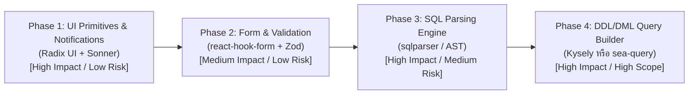

# Implementation Plan: Library Refactoring & Modernization Roadmap

แผนการปรับปรุงระบบโดยเปลี่ยนโค้ดที่เขียนขึ้นเองบางส่วนไปใช้ **ไลบรารีสำเร็จรูปมาตรฐาน (Off-the-shelf Libraries)** เพื่อเพิ่มความเสถียร, มาตรฐาน Accessibility (A11y), และลดความซับซ้อนในการดูแลรักษาโค้ดระยะยาว

> **For agentic workers:** เมื่อเริ่มดำเนินการแต่ละ Phase ให้ปฏิบัติตามกฎของโปรเจกต์อย่างเคร่งครัด:
> 1. เปิด GitHub Issue ก่อนเริ่มงาน (`gh issue create`)
> 2. อัปเดตเอกสารสเปคใน `docs/db-manager-plan.md`
> 3. พัฒนาแบบ TDD พร้อม automated tests ให้ผ่าน 100% (`pnpm test`, `pnpm build`, `cargo test`)
> 4. Commit และปิด issue (`gh issue close`) พร้อม Push ขึ้น remote

---

## 🎯 สรุปภาพรวมและลำดับความสำคัญ (Phased Roadmap)

---

## Phase 1: ปรับปรุง UI Modals, Context Menu และระบบแจ้งเตือน (Radix UI + Sonner)

### เป้าหมาย
แทนที่การเขียน CSS Overlay Modal และ Context Menu แบบ manual ด้วย **Radix UI Primitives** เพื่อให้ได้คุณสมบัติ Focus trap, Keyboard navigation, A11y, Collision detection และเพิ่มระบบ Toast Notification ด้วย **Sonner**

### รายการไลบรารีที่จะติดตั้ง
* `@radix-ui/react-dialog`
* `@radix-ui/react-context-menu`
* `@radix-ui/react-dropdown-menu`
* `sonner`

### ไฟล์ที่จะถูกแก้ไข/สร้างใหม่
1. **Component Dialogs:**
   * `src/components/dialogs/ConnectionDialog.tsx` → ใช้ `Dialog.Root`, `Dialog.Portal`, `Dialog.Content`
   * `src/components/structure/CreateTableModal.tsx` → ใช้ Radix Dialog
   * `src/components/structure/DropTableModal.tsx` → ใช้ `AlertDialog.Root` (เหมาะกับ destructive action)
2. **Context Menus:**
   * `src/components/sidebar/ObjectBrowser.tsx` & `ConnectionTreeNode.tsx` → ใช้ `ContextMenu.Root`, `ContextMenu.Trigger`, `ContextMenu.Content` ป้องกันปัญหาเมนูล้นหน้าจอ
3. **Toast Notifications:**
   * `src/App.tsx` → ติดตั้ง `<Toaster richColors position="bottom-right" />`
   * แจ้งเตือนเมื่อ Query รันสำเร็จ, มี Error, หรือ Commit/Rollback สำเร็จ

### การทดสอบ (Verification)
* รัน `pnpm test` (อัปเดต snapshot/test cases ของ Modal & Dialogs ใน Vitest)
* ตรวจสอบการกดปุ่ม `Esc` เพื่อปิด Modal และการกดคีย์บอร์ดนำทางใน Context Menu

---

## Phase 2: ยกระดับการจัดการฟอร์มและตรวจสอบข้อมูล (React Hook Form + Zod)

### เป้าหมาย
เปลี่ยนการจัดการ state ฟอร์มที่กระจายตัวอยู่ด้วย `useState` หลายตัวในหน้าเชื่อมต่อและสร้างตาราง ให้รวมศูนย์ผ่าน Schema Validation ด้วย **Zod** และควบคุม State ผ่าน **React Hook Form**

### รายการไลบรารีที่จะติดตั้ง
* `react-hook-form`
* `@hookform/resolvers`
* `zod`

### ไฟล์ที่จะถูกแก้ไข/สร้างใหม่
1. **Validation Schemas:**
   * สร้าง `src/schemas/connectionSchema.ts` (ตรวจสอบ Host, Port, Database name, SSL mode ตาม Driver)
   * สร้าง `src/schemas/tableSchema.ts` (ตรวจสอบชื่อคอลัมน์ไม่ซ้ำ, Data type และ Length)
2. **Form Components:**
   * `src/components/dialogs/ConnectionDialog.tsx` และ `DriverForm.tsx` → ใช้ `useForm` พร้อม `zodResolver`
   * `src/components/structure/CreateTableModal.tsx` → ใช้ `useFieldArray` สำหรับจัดการรายการคอลัมน์แบบ dynamic (เพิ่ม/ลบ/จัดลำดับคอลัมน์)

### การทดสอบ (Verification)
* Unit test ตรวจสอบ Zod Schema ครอบคลุม Invalid cases (เช่น Port ติดลบ, ชื่อตารางมีอักขระพิเศษที่ไม่อนุญาต)
* Component test ตรวจสอบการแสดงผล Error message สีแดงใต้ input field

---

## Phase 3: ปรับปรุงตัวตัดคำสั่ง SQL (SQL Statement Parsing & Splitting)

### เป้าหมาย
แทนที่การสแกน character loop ด้วยมือใน `sqlSplitter.ts` ด้วยไลบรารี Parser ที่ได้มาตรฐาน เพื่อรองรับกรณีคำสั่งซับซ้อน เช่น Dollar-quoted strings ใน PostgreSQL (`$$...$$`), Stored Procedures, และ Nested block comments

### แนวทางเลือก (Technical Choice)
* **ทางเลือก A (Frontend):** ใช้ไลบรารี `@flighter/sql-parser` หรือ `node-sql-parser` / `sql-split`
* **ทางเลือก B (Backend ผ่าน Rust - แนะนำเพื่อความแม่นยำสูงสุด):** ใช้ crate [`sqlparser`](https://crates.io/crates/sqlparser) ใน Rust Backend แล้วส่งผลลัพธ์ statement range ผ่าน Tauri IPC

### ไฟล์ที่จะถูกแก้ไข/สร้างใหม่
* `src/api/sqlSplitter.ts` หรือ `src-tauri/src/commands/db.rs` (เพิ่ม command `split_sql_statements`)
* `src/api/sqlSplitter.test.ts` (เพิ่ม test cases สำหรับ Dollar-quote `$$`, Triggers, Functions)

### การทดสอบ (Verification)
* รันชุดทดสอบเดิมที่มีอยู่ทั้งหมดใน `sqlSplitter.test.ts` เพื่อให้มั่นใจว่า Backward Compatible
* เพิ่ม Regression Test กรณี Syntax เฉพาะทางของ PostgreSQL และ MySQL

---

## Phase 4: สร้างคำสั่ง DDL & DML อย่างปลอดภัย (Type-Safe Query Builder)

### เป้าหมาย
แทนที่การต่อ String เองใน `tableStructureHelpers.ts`, `tableManagementHelpers.ts`, และ `tableEditHelpers.ts` เพื่อป้องกันปัญหา Reserved Keyword ชน และ Syntax ต่าง Dialect

### แนวทางเลือก (Technical Choice)
* **Frontend:** ใช้ [`Kysely`](https://kysely.dev/) สำหรับ Schema DDL generation
* **Backend:** ใช้ [`sea-query`](https://crates.io/crates/sea-query) ใน Rust เพื่อสร้าง DDL/DML ก่อน execute

### ไฟล์ที่จะถูกแก้ไข/สร้างใหม่
* Refactor `buildCreateTableSql`, `buildDropTableSql`, `buildUpdateSql`
* Unit tests ครอบคลุมการสร้างคำสั่งทั้ง 3 Drivers: SQLite, PostgreSQL, MySQL

---

## 📋 คำแนะนำขั้นตอนการเริ่มงานต่อไป
1. **เลือกเริ่มต้นที่ Phase 1** (Radix UI + Sonner) เพราะทำได้ทันที มีความเสี่ยงต่อ business logic ต่ำสุด และยกระดับ UX ของโปรแกรมอย่างเห็นได้ชัด
2. เมื่อผู้ใช้ยืนยัน Phase ที่ต้องการทำแล้ว ผู้ช่วยจะดำเนินการ:
   - ใช้ `gh issue create` เพื่อสร้าง Issue ประจำงาน
   - อัปเดต `docs/db-manager-plan.md`
   - เริ่มติดตั้งไลบรารีและพัฒนาแบบ TDD ทันที
